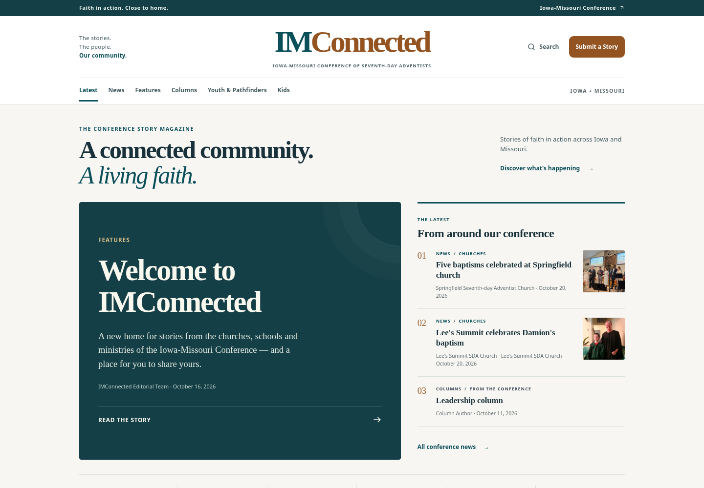
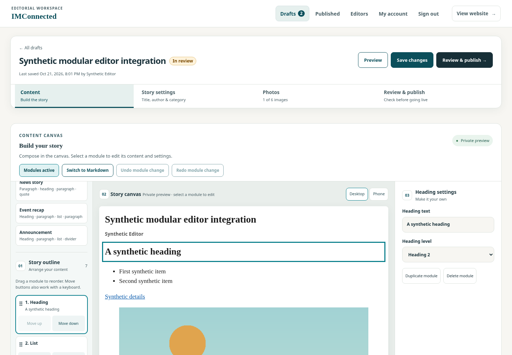
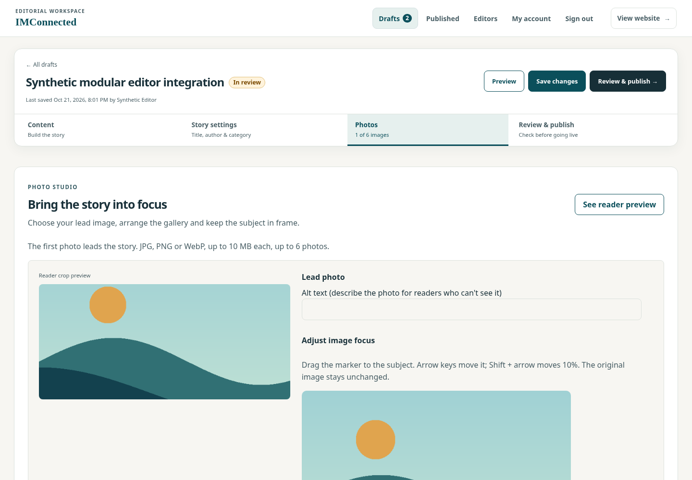
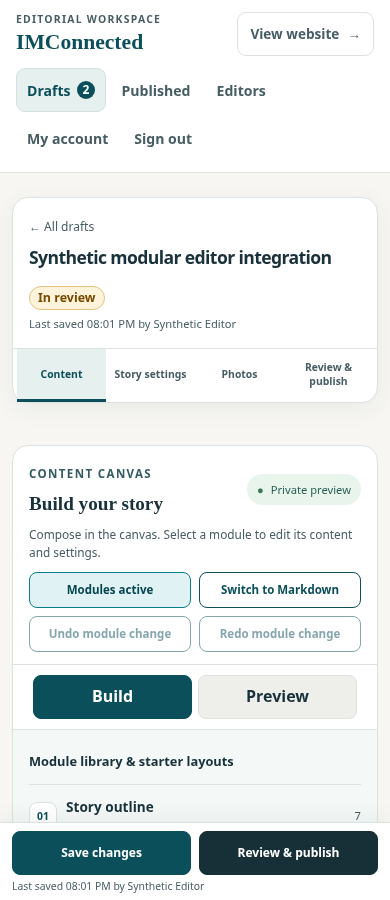
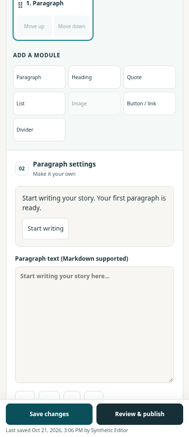
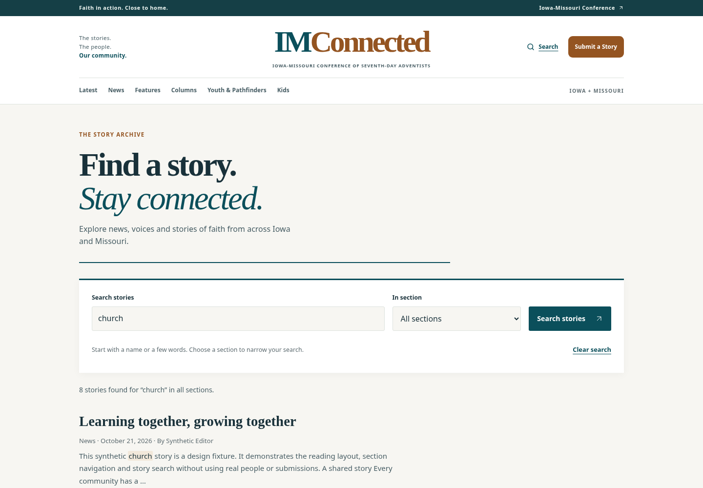

# Magazine and editorial studio redesign

This change follows the content-outline, task-focused panels, labelled actions, mobile reflow and private-preview direction in [IMSDA Events #1114](https://github.com/DurantTL/IMSDA-Events/issues/1114). It keeps IMConnected's routes, editorial permissions, SQLite source of truth and human publishing action.

## Canvas and search follow-up

This follow-up starts from the refreshed `main` at `d218010`, including the later module-safety, live-edit and no-JavaScript fixes. [The feature review](ISSUE_FEATURE_REVIEW.md) records coverage and remaining access gaps for the owner's #3–#38 review range.

- Desktop editing now puts the library/outline at the left, the composed story canvas in the center and the selected module's settings at the right. Canvas selection has a visible highlight and Enter/Space support while preserving native headings and lists. Phone Build/Preview views hide and inert inactive panes.
- The module library has search, result feedback and a clear recovery action. **News story**, **Event recap** and **Announcement** insert empty starter structures after the selection, preserve existing content and undo atomically. The 60-module cap applies to the whole insertion.
- Published and rejected drafts preview their stored content and photo focus. Their disabled form controls no longer cause an empty preview, and posted replacement data cannot override the saved preview. The frame retains its restrictive CSP and script-disabled sandbox.
- Public story search has a new discovery layout, visible labels, automatic section filtering, clear/reset and no-match recovery. Query/section feedback reflects the returned count, including the 20-result cap. URL history and request ordering are covered by browser regressions.
- Issue **#38** was reproduced with only 50 of 121 stored stories indexed. Initial search now reports temporary unavailability until all live, non-draft rows have current index stamps. Catch-up runs in bounded background batches and retries after locks. Restart, failed-row and steady-state repair behavior are covered by tests.

## Image zoom and pan follow-up

The Photos panel now has a crop you can drag, keyboard panning, 100–300% Zoom, +/− buttons and Reset crop. The existing focal marker and horizontal/vertical sliders remain available. Saved metadata follows a photo through publish, live-story reopening, imports/adoption, private previews, inline modules, public cards/layouts and the optional version-1 feed fields. Original image bytes and full-image links remain intact. The editor uses a 16:9 crop preview; cards, paired photos and galleries keep their own proportions around the same focal point.

Migration 018 supplies 100% zoom for existing draft/published photos. Older forms that omit crop fields preserve saved values. No Studio or agent API request fields changed. An older server image does not understand zoom and may reset it if it republishes a story; use a current image for editing cropped photos.

Synthetic screenshots, viewable directly on GitHub:

- [Desktop zoom and pan controls](design/story-photo-zoom-pan-desktop.png)
- [Phone zoom and pan controls](design/story-photo-zoom-pan-mobile.png)

Verified against the crop build: 25 module checks, SQLite builder integration, 96 builder browser checks including axe, 183 editor draft checks, the pending-save publish regression, 94 photo layout/viewer checks including an upgrade with existing photos, 24 import checks, 201 agent API checks, 104 design checks across 30 responsive screens, and 37 public-page checks. Four old-markup comparison groups were explicitly skipped; pre-redesign byte comparisons do not apply to the magazine redesign. Tests used temporary local data, made-up credentials and synthetic photos. Independent read-only Sol review found no blocking or medium defects.

## What changed after the design review

The earlier pass left the existing page structure mostly intact: a large empty hero placeholder, lightly restyled navigation, and a long editor form with the module tools inserted halfway down. This revision changes those structures.

- The public site has a publication masthead, separate section-navigation band, typographic feature cover, numbered latest-story rail, topic directory and a redesigned conference board. Stories without photographs use an intentional text cover instead of a large empty picture placeholder.
- Article pages have a clearer breadcrumb/headline/byline hierarchy and a focused reading column. The footer has a stronger submission invitation. Existing story URLs, feeds, section routes and image focus remain supported.
- The editor starts with its content workspace. Metadata is in **Story settings**, image management is in **Photos**, and publishing is in **Review & publish**. A desktop sticky toolbar keeps Save and private Preview available; phones use a compact bottom Save/Review bar and let the header scroll away. Inactive panels are hidden and inert while their fields remain part of the saved form.
- Desktop editing uses a library/outline, central story canvas and selected-module settings. The outline and settings can scroll independently. Mobile has explicit task tabs and Build/Preview controls rather than offscreen panels that remain keyboard-focusable.
- Paragraph, heading, quote, list, image, button/link and divider modules support ordering, duplicate/delete and undo/redo. Existing Markdown is retained; empty new drafts begin with a paragraph module. Previewing does not publish.
- Photo editing shows a reader-crop preview beside the original image and focal marker. Dragging, arrows, Shift+arrows, labelled sliders and Center focus all update the stored point. Original image proportions are preserved in the focal pad so pointer coordinates match the image.
- Additive migration 017 stores modules and focal coordinates. Save/publish/live-edit round trips retain them, and the save queue flushes later edits before publishing or photo operations.

## GPT delegation and follow-up review

[CODEX.md](../CODEX.md) and `.codex/agents/` adapt the delegation workflow to the owner's mapping: **Haiku → Luna, Sonnet → Tera, Opus → Sol, Astra → Fable**. The configuration pins the available Luna explorer and Sol reviewer. Tera/Fable were unavailable in the setup session, so their roles explicitly inherit the session model and require disclosure of the actual model. They have no invented model IDs. The TOML files were checked against the current official Codex configuration schema.

The follow-up used Luna for research, an already-running `gpt-6.1-sol` implementation assignment, and `gpt-6-sol` for the final independent review after the mapping correction. Tera and Fable were not run. The main session integrated and verified the changes.

- Phone editing has a compact bottom action bar with saved status and safe-area spacing. Desktop actions leave the keyboard order when hidden, and the editor reserves room below content for the phone bar.
- New stories show an explicit Start writing action and a paragraph placeholder. Opening a story does not automatically focus a text field on phones.
- Module selection, duplicate/delete, undo/redo and image selection retain deliberate keyboard focus after controls are recreated.
- Stories with every photo placed inline retain their photo credit once. Existing lead/layout credits remain escaped and appear once. Blank-alt inline images have a named enlargement link without inventing image descriptions.

## Website

These two screenshots were generated from a throwaway database that holds only synthetic stories (made-up text and people, generated illustrations, no real names or churches).




## Story editor

These editor screenshots use a synthetic account, synthetic text and a generated landscape image. They contain no real account or submission details.









## Story search

These screenshots use the synthetic story fixtures from the responsive design crawl.




## Validation

The production Astro build passed. The design crawl checked home, section, story, submission, search and sign-in screens at 360, 390, 768, 1024 and 1440 pixels (30 responsive screens), including keyboard navigation, overflow, script errors, the header's current-page markers and axe WCAG A/AA checks. All four editor panels also passed axe WCAG A/AA checks.

After refreshing the Git baseline, the follow-up passed **24 module checks**, SQLite round-trip integration, **82 builder browser checks**, **110 search checks**, **183 editor checks**, the pending-save regression and **104 design checks across 30 responsive screens**. The enhanced canvas DOM was also audited as an exact snapshot in a separate diagnostic page because asynchronous axe execution cannot run inside its script-disabled frame; real-frame keyboard and semantic-role checks ran directly. The final independent Sol review found no blocking or medium findings. All listed follow-up checks completed with no failures or skips.

**Why the baseline comparisons were not used.** `scripts/test-public-pages.mjs` can compare rendered pages with a historical build (`BASELINE_DIR`). Those comparisons assume the page markup did not change, which does not hold for an intentional redesign, so they were not applicable here and were not run (the script is unchanged and reports them as skipped, never as passes). Instead, during the review of this branch, Claude Code compared local builds of the previous main (`8e1c61a`) and this branch on the 5 stories in the frozen archive: 20 pages at 390 and 1280 pixels, all answered 200, with the same photos, credits and headlines, no horizontal overflow and no script errors.

**Review follow-up.** An independent review plus test runs found problems that are fixed on this branch: module text is escaped like the body (`<` stored as `&lt;`) and the renderer shows it literally; image modules add nothing to the Markdown projection and may only show the story's own photos (never an external address); a Markdown-box edit on a modular draft is refused instead of silently dropped; modules together are limited to the 20,000-character body limit, and "Use modules" splits between paragraphs; the From AI agent badge is back on the draft page; the editor tests use the Save control that is actually visible at each width; the header marks only the current page and the phone menu has a Latest link; outline controls' accessible names start with their visible text; opening an empty draft no longer autosaves; the private preview loads only the story's own photo paths.

Browser and integration tests use isolated local data and mock requests. Live WordPress, SSO, email, Google Drive, production publishing and every Gmail/Outlook rendering combination were not exercised. This is a modular story editor, not a form-response, payment or conditional-logic engine.

Reproduce the key checks after `npm ci` and `npm run build`. Playwright and axe are not dependencies: they resolve normally, and `PLAYWRIGHT_ROOT` (a folder whose `node_modules` has Playwright), `CHROMIUM_PATH`, `CHROMIUM_NO_SANDBOX=1` (needed when running as root, for example in a container) and `AXE_JS` (path to `axe.min.js`) override that.

```bash
node scripts/test-story-blocks.mjs
node scripts/test-story-builder.mjs
node scripts/test-story-builder-ui.mjs
node scripts/test-editor-save-race.mjs
AXE_JS=/path/to/axe.min.js node scripts/test-design-review.mjs
```

The editor, submission, public-page, photo-layout, search, import and agent suites are listed in `AGENTS.md`. This branch contains code changes only and has not been deployed or merged to the production branch.

## Inline galleries

The Markdown gallery picker places a bounded range of story photos inside the article. Requested three-column galleries use two columns on phones; crops and original-image links remain available. Synthetic captures: [desktop](design/story-gallery-1440.png) and [phone](design/story-gallery-390.png). The built editor passed 106 browser checks with axe; the marker/module contract suite passed 47 checks.

## Announcements and event flyers

The community board adds a magazine-style invitation header, full-aspect flyer cards, event dates/locations, link actions and accessible type filters. Detail pages support full-height flyers and click-to-load video players. Synthetic screenshots: [board desktop](design/announcements-board-desktop.png), [board phone](design/announcements-board-mobile.png), [article desktop](design/announcement-story-desktop.png), [article phone](design/announcement-story-mobile.png).

## Saved draft revisions

Review & publish includes persisted revision history, separate from canvas Undo. Restore returns to Review with visible confirmation and, when needed, a missing-photo warning outside the closed history disclosure. Draft controls are temporarily unavailable while restore is pending, and become available again if it fails. The [synthetic review capture](design/story-revision-history.png) shows both notices without exposing private submission data. The browser regression opens history for an axe audit, exercises delayed restore failure and retry, and verifies that a deleted photo's reused numeric ID cannot attach an older marker to its replacement.
