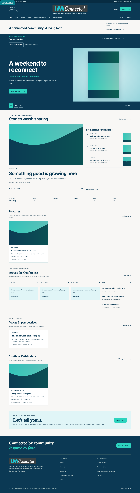
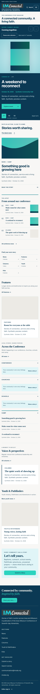
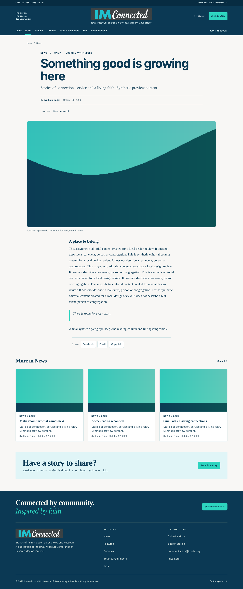
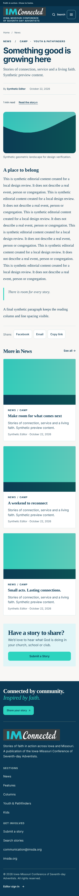
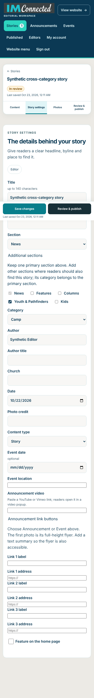

# IMConnected publication design

Issue #77 applies the supplied IMConnected branding and the colors read from the owner's newsletter draft. The draft is reference data only; its newsletter content is not part of the repository or test fixtures. Issue #76 supplies the related [multiple-section workflow](MULTIPLE-SECTIONS.md).

## Brand and color

The header, footer and editor use one local IMConnected wordmark. The artwork was prepared from the conference's existing public IMConnected artwork: an image-generation crop removed its unrelated generated subtitle and retained the cyan IM / white Connected lettering on charcoal. The resulting opaque asset was encoded as a 34 KB WebP at `public/images/brand/imconnected-wordmark.webp`. It makes no third-party image request. `BrandMark.astro` supplies the accessible name once inside each brand link.

The newsletter palette is shared by public and editor screens:

| Role | Color |
| --- | --- |
| Primary teal | `#087E8B` |
| Dark navy | `#0B3954` |
| Pale aqua | `#E0F5F7` |
| Mint accent | `#2DD4BF` |
| Newsletter background | `#ECEAE5` |
| Content background | `#F8F7F5` |

Small links and category labels use navy on light backgrounds to meet text contrast requirements; primary teal remains available for buttons and larger accents. Mint outlines show keyboard focus on navy headers. The publication keeps these colors under either operating-system color preference.

## Homepage and article layout

The full-width event stage gives the flyer and invitation room above the news. A larger lead story, latest-story rail, strong sans-serif headlines and warm content surfaces establish the publication hierarchy. Article headlines and photography occupy a wider frame while the serif reading column stays around 66 characters wide. Article metadata adds estimated reading time and a jump to the story body. Primary and additional section links remain available.

[Northwest Adventists](https://nwadventists.com/) informed the dominant-media hierarchy, [Adventist Record](https://record.adventistchurch.com/) the lead-story/teaser balance, and [Adventist Review](https://adventistreview.org/articles/a-bogus-doctrine) the article hierarchy and reading column. These are layout references; no reference-site photography, article copy or implementation was copied. The automatic slider is the owner's requested addition, rather than a claim about the reference sites' behavior.

## Homepage recency

The hero, the latest rail, the Features, Voices, Youth and Kids blocks and the Across the Conference areas draw only from stories dated within the last 90 days (`HOMEPAGE_RECENT_DAYS`, one constant in `src/lib/public-stories.ts`, counted by the America/Chicago day) plus any story marked featured regardless of date, so a featured older story can still lead the hero. A block with fewer stories than it has room for shows fewer instead of reaching into the archive, and an empty news area keeps its invitation to share a story. The event spotlight, section pages, search and feeds are unchanged and still cover every published story. The window moves with the calendar rather than with a publish, so the cached home page can keep a story for up to one cache TTL (10 minutes) plus the Cloudflare/browser window (about 6 minutes) past its 90th day; this is accepted. `scripts/test-homepage-recent.mjs` covers the boundary.

### From the archive rail

Below the story blocks and above the submit call to action, "From the archive" (eyebrow, heading, the line "Stories from past issues of IMConnected" and a link to `/issues/`) shows four stories older than the recency window; phones show three (the fourth is hidden in CSS). `archiveRail()` in `src/lib/archive-rail.ts` is a pure function: it drops stories already shown higher on the page (for example an old featured story in the hero), sorts the rest by id, shuffles them with a generator seeded by the America/Chicago day (`conferenceDay()`), then prefers stories with a photo and takes one per section before repeating a section. The same day therefore gives every reader the same four and the page cache stays valid; the set changes at the Chicago midnight (plus the cache window). Owner decision: any story with an announcement or event is excluded, so an expired event is never re-posted as if current; only ordinary stories qualify. The rail also excludes everything above it, including the event spotlight (which keeps old-dated upcoming and undated events). Fewer than two qualifying stories hides the block. Cards are the ordinary grid cards, so each shows its original date and a placeholder when it has no photo. The archive link is the single constant `ARCHIVE_LINK` (`/news/` for now; the issues browser switches it to `/issues/`), and `archive-rail.ts` marks where "Issue #N" goes once newsletter-issue data exists. `scripts/test-archive-rail.mjs` unit-tests the selection with an injectable day; `test-homepage-recent.mjs`, `test-design-review.mjs` (row alignment and axe at five widths) cover the rendered block.

## Event spotlight behavior

Only published upcoming Events appear, at most six, ordered by the conference's America/Chicago calendar day. The lead flyer stays uncropped. Announcements retain their own board and editor queue.

- Two or more events advance every seven seconds and wrap to the first event. Manual Previous/Next (which wrap, so they are never disabled), numbered choices, keyboard arrows and native scrolling remain available.
- The pause/play toggle is an icon-only button in the numbered navigation row (after the event links in the Tab order); its label changes between "Pause automatic advance" and "Resume automatic advance". Pause persists until Resume is explicitly selected. A finger on the track pauses rotation only while it is down; a horizontal swipe counts as the reader taking over and stops automatic advance until Resume is pressed, while vertical page scrolling does not. Only keyboard focus (not a tap) holds rotation. Hover, focus inside the spotlight, an offscreen spotlight and hidden tabs suspend automatic movement; leaving those conditions can resume it unless the reader paused.
- Reduced motion disables automatic movement and makes manual jumps instant. Turning reduced motion off does not restart a rotation the preference stopped.
- Automatic changes never move keyboard focus or make repeated live-region announcements. Manual/paused position feedback remains available. Returning through the browser's page lifecycle reschedules rotation only when eligible.
- With one event, the event remains readable without automatic controls. With no upcoming events, the stage is absent. Without JavaScript, all event cards and links remain readable through native scrolling.

The public navigation editor, module-library favorites, crop zoom/pan, original-image links and human publication rules remain part of the existing workflows. See [community navigation](COMMUNITY-NAVIGATION.md).

## Review screenshots

These screenshots contain only synthetic stories, made-up people and generated local illustrations. They show the new implementation rather than live production content.











## Verification

Build before running the browser checks. Playwright and axe remain external test tools, with the environment overrides documented in [the design review](DESIGN_REVIEW.md).

```bash
npm run build
AXE_JS=/path/to/axe.min.js node scripts/test-publication-redesign.mjs
AXE_JS=/path/to/axe.min.js node scripts/test-design-review.mjs
AXE_JS=/path/to/axe.min.js node scripts/test-story-builder-ui.mjs
SCRATCH=/tmp/imc-publication-photos node scripts/test-photo-layouts.mjs
SCRATCH=/tmp/imc-publication-pages node scripts/test-public-pages.mjs
```

Checks run for this change: `npm run build` and every `scripts/test-*.mjs` suite with the environment overrides above (`PLAYWRIGHT_ROOT`, `CHROMIUM_PATH`, `AXE_JS`). The redesign suite covers axe on the homepage, the editor under an emulated dark colour scheme and the editor list pages, plus keyboard focus-ring contrast and screenshots. The public-page suite skips four historical markup comparisons because no baseline was supplied, which is intentional for this redesign. `test-studio-announcements.mjs` times out waiting for the Studio import menu, identically on `main`.

The dedicated redesign suite requires axe and checks the palette/wordmark, automatic/manual event navigation, pause persistence, hover/focus/visibility, reduced motion, no-JavaScript reading, touch, single/empty event states, article/category links, phone editor settings and WCAG A/AA scans. Page lifecycle/hidden-tab cases dispatch synthetic browser events; they do not prove a real browser's back-forward cache behavior. Tests use temporary local SQLite databases and generated media. Production services and real publication are not exercised. Historical byte-for-byte public markup comparisons are inapplicable to this intentional redesign and are reported as skipped by the public-page suite.
